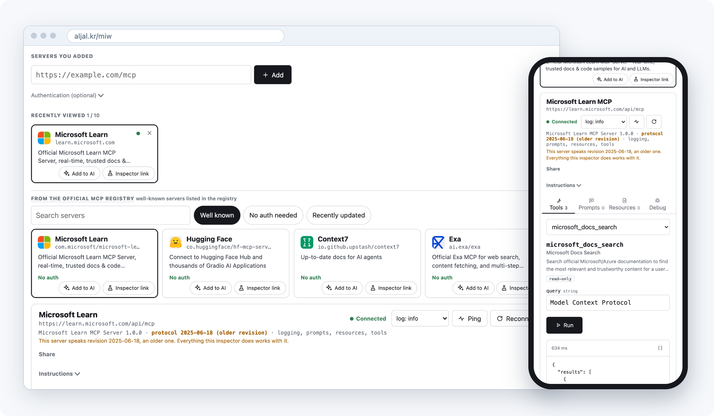
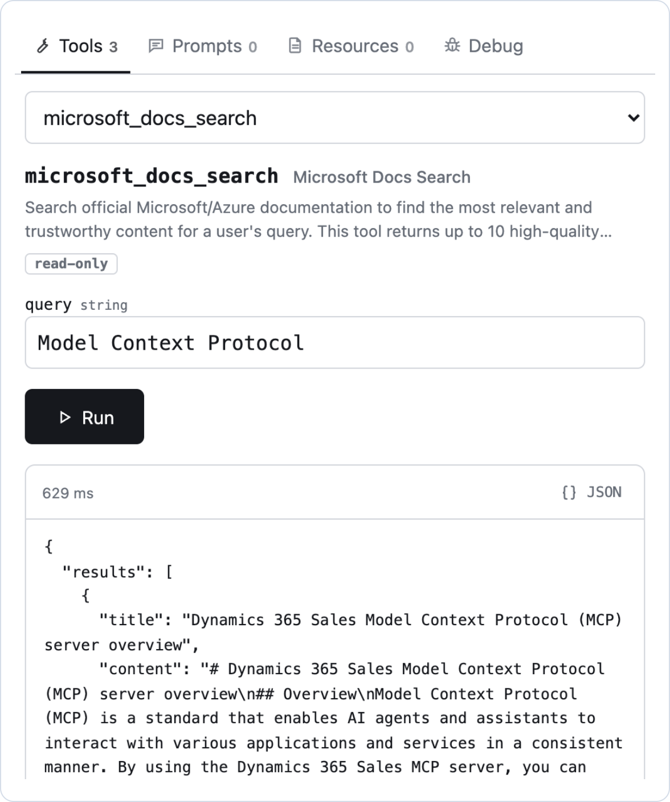
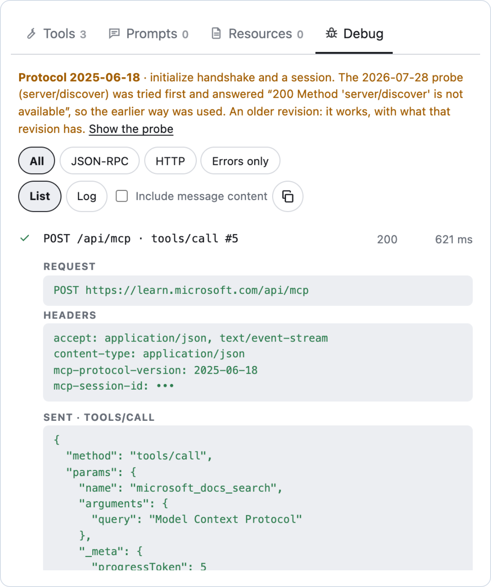
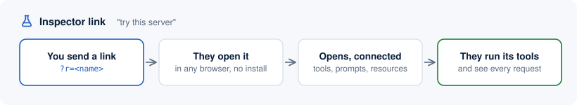
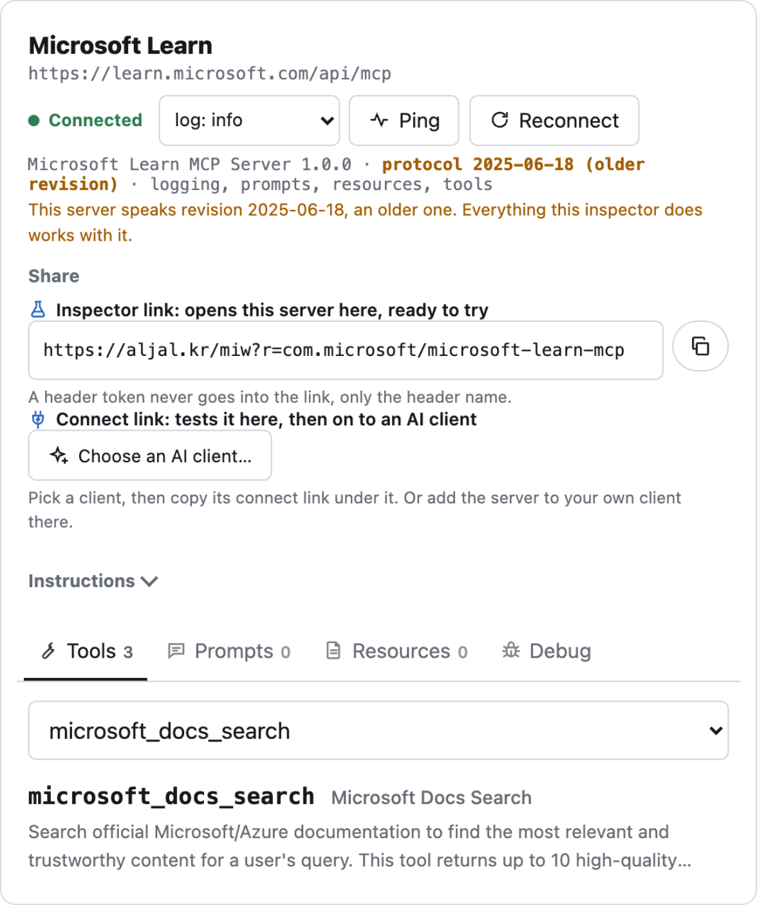
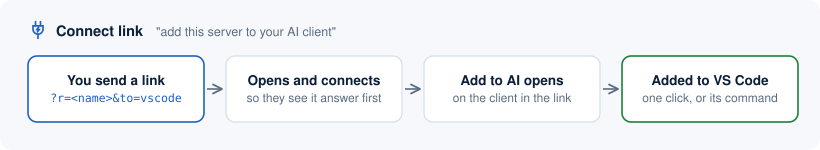
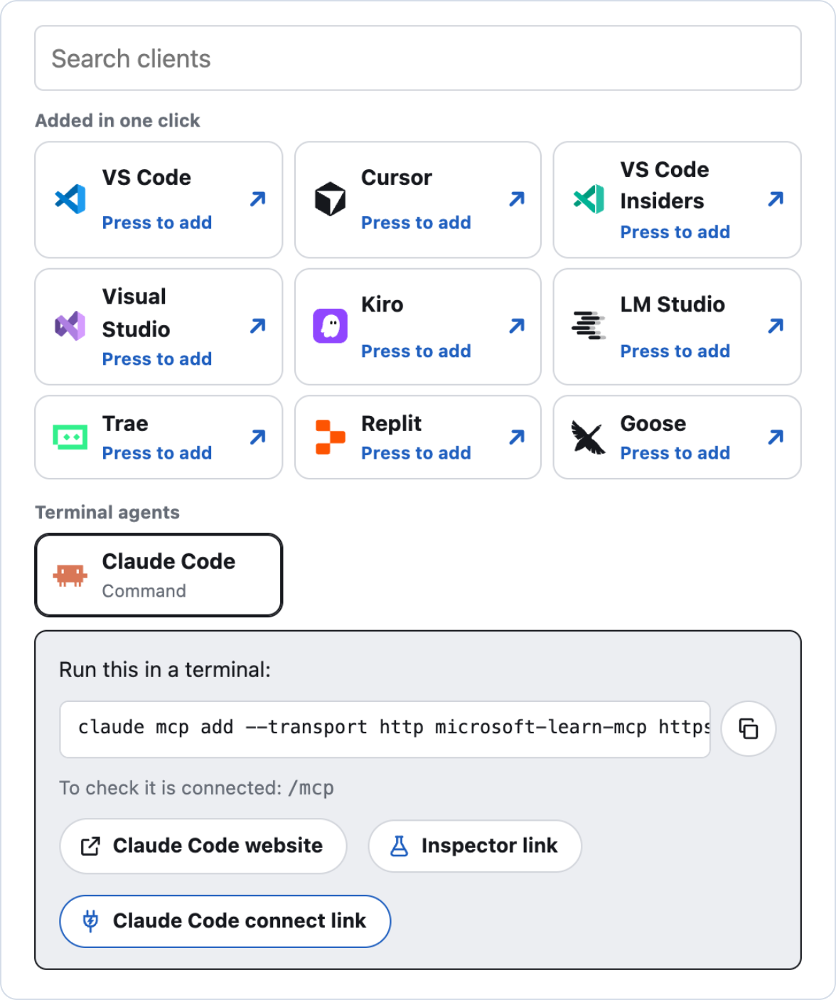
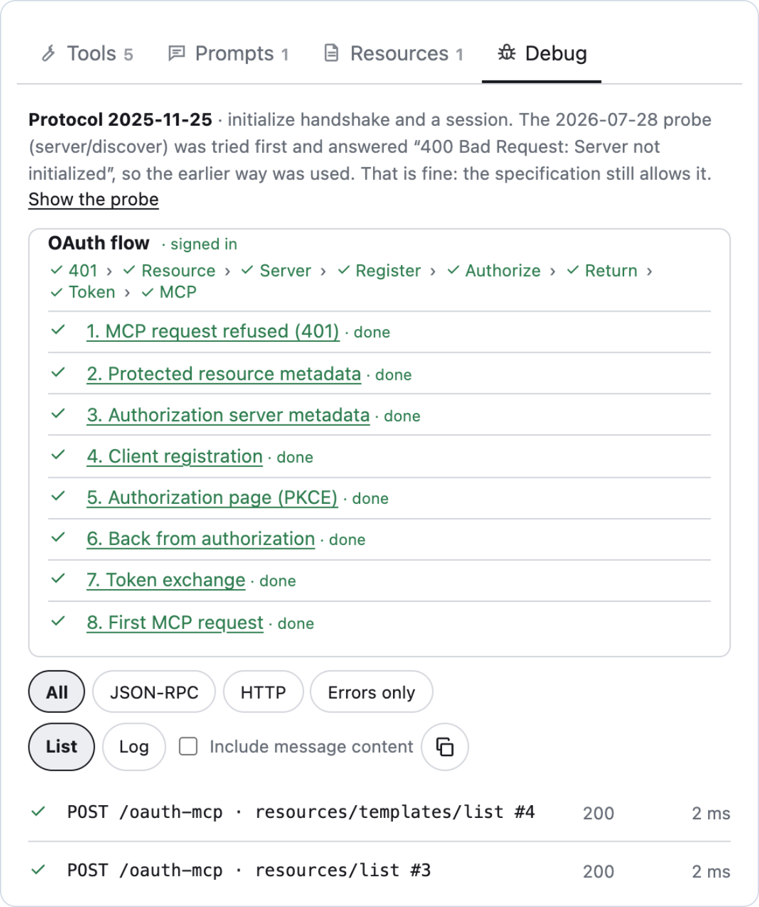
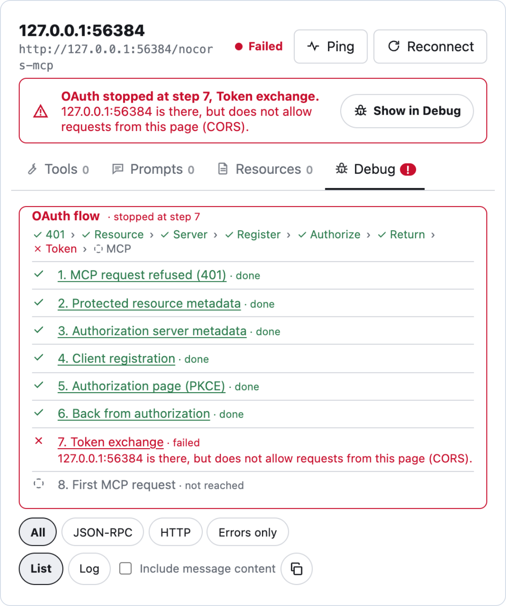
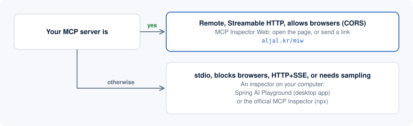

<div align="center">

# MCP Inspector Web

**The MCP inspector that is a link.**<br>
Open a remote MCP server in a browser tab, run its tools, see every request and the OAuth sign-in step by step,<br>
then hand it on in one link: to try it, or to add it to an AI client.

No install, no backend, no proxy: the page talks to the server directly, on desktop and mobile.

<a href="https://aljal.kr/miw"></a>

[](https://github.com/JM-Lab/mcp-inspector-web/actions/workflows/ci.yml)
[](LICENSE)

<a href="https://aljal.kr/miw?r=com.microsoft/microsoft-learn-mcp"></a>

 **Inspector link**: [open Korea Basics, ready to try its tools](https://aljal.kr/miw?r=kr.aljal.basics/korea-travel), an MCP server with travel info for visitors to South Korea: entry rules, places, festivals and holidays<br>
 **Connect link**: [test Microsoft Learn, then add it to VS Code in one click](https://aljal.kr/miw?r=com.microsoft/microsoft-learn-mcp&to=vscode), Microsoft's MCP server for searching its official docs

[Live demo](https://aljal.kr/miw) ([한국어](https://aljal.kr/ko/miw)) · [Share](#share-it-in-one-link) · [Debug](#debug) · [Use it](#use-it) · [Options](#options) · [Limits](#where-it-works) · [Report a bug](https://github.com/JM-Lab/mcp-inspector-web/issues/new/choose)

</div>

## Four things it does

### 1. Inspect, online

Connect to a remote server from the page itself and run its tools, prompts and resources. Nothing to install, and nothing in between: your browser talks to the server. It works on mobile too, so a link someone sends you opens wherever you read it.

<p align="center"></p>

### 2. Debug

Every HTTP request with the JSON-RPC message it carried, the OAuth sign-in as eight steps, and in words why a connection failed. Tokens and codes are never shown.

<p align="center"></p>

### 3.  Inspector link

One link opens a server here, connected and ready to try. Send it to a teammate, or put it in your server's README.

<p align="center"></p>

```text
https://aljal.kr/miw?r=kr.aljal.basics/korea-travel
```

<p align="center"></p>

### 4.  Connect link

The same link, going one step further: it tests the server, then adds it to the AI client you named. 44 clients, in one click where the client allows.

<p align="center"></p>

```text
https://aljal.kr/miw?r=com.microsoft/microsoft-learn-mcp&to=vscode
```

<p align="center"></p>

## Share it in one link

Every server card and the open server's **Share** box have both links, and the **Add to AI** button. A link never carries a token, only the header name. OAuth starts only when its button is pressed.

### For server authors: publish to the Official MCP Registry first

Any server address works, but a server listed in the [Official MCP Registry](https://registry.modelcontextprotocol.io) gets a short link by its name, and more:

| | Listed in the Official MCP Registry | Not listed |
| --- | --- | --- |
| Inspector link | `…/miw?r=io.github.you/weather` | `…/miw?u=mcp.example.com/v2/mcp&h=X-API-Key` |
| Connect link | `…/miw?r=io.github.you/weather&to=vscode` | `…/miw?u=mcp.example.com/v2/mcp&h=X-API-Key&to=vscode` |
| Title, description, icon | read from the registry | the address only |
| The header token it needs | read from the registry, its field shown at once | named in the link with `&h=` |
| When the address changes | the same link still works | every link given out breaks |
| Found by search here | yes | no |

To list it, publish its `server.json` with the registry's `mcp-publisher` tool: see the registry's [quickstart](https://github.com/modelcontextprotocol/registry/blob/main/docs/modelcontextprotocol-io/quickstart.mdx) and [remote servers](https://github.com/modelcontextprotocol/registry/blob/main/docs/modelcontextprotocol-io/remote-servers.mdx) guides. Then press **Inspector link** on its card here, or write `?r=<its name>` yourself. A private or local server that should not be listed keeps working with `?u=`.

<details>
<summary><b>Add to AI: the client list, phones and tokens</b></summary>
<br>

**Add to AI** on a card (or **Choose an AI client…** in the Share box) opens the client list.

- **One-click clients come first.** Pressing one of their tiles starts adding at once: the app opens and asks you to confirm. Pressing it again tries again.
- **Every other client shows its way right under its tile**: one command, a config file, or the steps in its settings with what to paste. Every format was read from the client's own docs or source.
- **Under each client**: where to check that the server is connected (`/mcp`, for example), a link to the client's website, and both links to pass on: the inspector link and that client's connect link.
- **At the bottom, always**: the server address, for adding it by hand in any client not listed.

The popup remembers the client you picked last, and the address bar always holds the open server's inspector link.

**On a phone or tablet.** On a phone or tablet (detected from Client Hints or the user agent, iPad included), the popup says so at the top, lists the chat apps first since they are set up on their websites, and marks the rest **Computer only**: pressing them opens nothing, and their setup stays there to copy and send to your computer. On a computer, a one-click link starts the app even when it is closed, if it is installed. When nothing opens for a few seconds (the app is not installed, or the browser held the link back), the popup says to open the app first and press **Try again**, and opens the setup to add by hand. Each client links to where to get it.

**Tokens.** A server you set up and tested here with a header token goes to your AI client the same way: **Add to AI** puts your token in the command, install link or config, so what you copy works as it is. An install link that holds your token opens the app on your computer only, and the popup says not to send that link on; the links of Kiro and Replit go through their websites, so they always get `<token>` instead. A checkbox takes the token out again when you pass the setup on to someone else; then `<token>` (or the client's own secret input, in VS Code) stands where it goes, and a note says to put theirs in. A link never carries a token, only the header name, since links stay in browser history, server logs and chat previews. A server that signs in with OAuth gets a note that the client asks you to sign in. Claude and ChatGPT connectors take no header token (they connect with OAuth or no sign-in), and Codex CLI sends only `Authorization: Bearer` (from an environment variable the setup fills in), so the popup says when a server may not work there.

</details>

<details>
<summary><b>The 44 clients, and what each gets</b></summary>
<br>

| Group | Clients |
| --- | --- |
| Added in one click | VS Code, VS Code Insiders, Cursor, Visual Studio, Kiro, LM Studio, Trae, Replit, Goose |
| Terminal agents | Claude Code, Codex CLI, Gemini CLI, GitHub Copilot CLI, opencode, OpenClaw, Hermes Agent, Amp, Qwen Code, Factory Droid, Augment (auggie), Crush, Kimi Code CLI, Mistral Vibe, OpenHands, Warp |
| Editors and IDEs | Windsurf, Google Antigravity, Roo Code, Amazon Q Developer, Zed, JetBrains AI Assistant, Junie, Cline, Kilo Code, Continue |
| Chat apps, on their websites | Claude, ChatGPT, Gemini app, Mistral Le Chat, Perplexity, Copilot Studio, LibreChat, Open WebUI, Manus |

Install links are each app's own (`vscode:mcp/install`, `cursor://…/mcp/install`, `goose://extension`, `lmstudio://add_mcp`, `trae://…/mcp-import`, and web pages for Kiro, Visual Studio and Replit), not part of MCP, so only clients that publish one get a one-click button.

A few examples of what it gives for `https://mcp.example.com/mcp` with an `X-API-Key` header:

| Client | What you copy or press |
| --- | --- |
| Claude Code | `claude mcp add --transport http mcp-example-com https://mcp.example.com/mcp --header "X-API-Key: <token>"` |
| opencode | `opencode mcp add mcp-example-com --url https://mcp.example.com/mcp --global --header 'X-API-Key=<token>'` |
| VS Code | its tile opens VS Code (`vscode:mcp/install?…`); by hand, `.vscode/mcp.json` with a password input for the token |
| Hermes Agent | `~/.hermes/config.yaml` (its add command takes no header, so the token goes in the file) |
| Perplexity | the steps in its Plugins page, the address to paste, and a note to pick API key and give the token |

</details>

<a id="the-add-to-ai-button-in-your-own-page"></a>
<details>
<summary><b>The Add to AI button in your own page</b></summary>
<br>

The popup is a UI component of its own. It knows nothing about the inspector and brings its own styles, so any page that lists MCP servers (a catalog, docs, a README site) can offer the same button.

So it has no link to the inspector either. Your page can add one with `shareLink`: a function that gets the client picked and returns your link, which the popup shows as a **… connect link** button. The inspector does exactly this, with `?r=<registry name>` or `?u=<server address>` and `&to=<client>` (see [Link forms](#link-forms)).

Give it a server in either of two ways: by its [MCP Registry](https://registry.modelcontextprotocol.io) name alone, or by its address directly (any server, registered or not, public or private).

```html
<script src="https://cdn.jsdelivr.net/npm/mcp-inspector-web@0/dist/mcp-add-to-ai.js"></script>

<!-- By registry name alone: the address, title and needed header are read from the registry -->
<mcp-add-to-ai registry="com.microsoft/microsoft-learn-mcp"></mcp-add-to-ai>

<!-- Directly: any server, with the name of the header token it needs -->
<mcp-add-to-ai url="https://mcp.example.com/mcp" name="Our server" header="X-API-Key" lang="ko"></mcp-add-to-ai>
```

```js
import { addToAiButton, openAddToAi, fromRegistry, clientsFor } from 'mcp-inspector-web/add-to-ai'

card.append(addToAiButton({ id: 'com.microsoft/microsoft-learn-mcp' }))              // registry name alone
card.append(addToAiButton({ url: 'https://mcp.example.com/mcp', name: 'Our server' })) // directly
openAddToAi({ url: 'https://mcp.example.com/mcp', header: 'X-API-Key' }, { lang: 'ko' })
await fromRegistry('com.microsoft/microsoft-learn-mcp')   // { url, name, id, header }
clientsFor({ url: 'https://mcp.example.com/mcp' })       // as plain data: [{ id, label, kind, link?, file?, code, steps?, note }]
```

| `<mcp-add-to-ai>` attribute, or server field | |
| --- | --- |
| `registry` (`id` in JS) | Its MCP Registry name. Alone, it is enough: the button reads the rest from the registry, and says so when the name is not there or has no remote address. |
| `url` | The server address (Streamable HTTP). Give it for any server not in the registry. |
| `name` | Shown in the popup, and the base of the name each client keeps it under. Given with `registry`, it replaces the registry title. |
| `header` | The name of the header token it needs. The setup gets `<token>` there and a note to put yours in. |
| `headers` (JS only) | The token itself, `{ name: value }`, for a server you set up: it is put in (`opts.secret: false` keeps it out), with a checkbox in the popup to take it out. |
| `oauth` (JS only) | `true` when it signs in with OAuth, for the note that the client will ask. |
| `lang`, `label` | `'en'` or `'ko'`, and the button text. In JS, `opts.ui` replaces any string. |
| `registry-api` (`registryApi` in JS) | Another registry API. Default: the official one. |
| `shareLink` (JS only) | `(client) => url`: a link of your page, drawn as a **… connect link** button under each client, in place of the client's own install link. It can also return several, each `{ url, label, hint, icon }`. The inspector passes its own: the page that opens this server, tests it, and comes back to that client (`&to=`). Leave it out and there is no such button. |

**Styling.** The button and popup take their colors and fonts from CSS custom properties, the same ones the inspector uses, so one theme covers both. Set them on the page, or on any element around the button:

```css
:root {
  --mcpi-ink: #0b1f3a;      /* text, the selected tile, the main button */
  --mcpi-mute: #5b6b80;     /* secondary text */
  --mcpi-rule: #d5dde8;     /* borders */
  --mcpi-card: #ffffff;     /* popup and tile background */
  --mcpi-tint: #eef3f9;     /* hover, banners */
  --mcpi-inv: #ffffff;      /* text on the main button */
  --mcpi-accent: #1f5fbf;   /* links */
  --mcpi-accent2: #c8102e;  /* warnings */
  --mcpi-sans: 'Inter', system-ui, sans-serif;
  --mcpi-mono: 'JetBrains Mono', monospace;
}
```

Every part has a class to style further: `.mcpi-addto-trigger` (the button), `.mcpi-addto` (the popup), `.mcpi-addto-tile`, `.mcpi-addto-detail`, `.mcpi-addto-go`, `.mcpi-addto-copy` and so on. `addToAiButton(server, { class: 'my-button', label: 'Install' })` uses your own button class and text, `opts.ui` replaces any text, and the element has no shadow DOM, so page styles reach it.

Client icons load from jsDelivr at fixed versions: [LobeHub Icons](https://github.com/lobehub/lobe-icons) (MIT) for most clients, [vscode-icons](https://github.com/vscode-icons/vscode-icons) (MIT) for VS Code and Visual Studio, and [Simple Icons](https://simpleicons.org) (CC0) for Zed, JetBrains and Warp. They are the makers' own marks, shown only to name each client. `opts.icons: false` leaves them out, and `{ clientId: url }` replaces some, for a page that must not reach a CDN.

`demo/add-to-ai.html` is a page with nothing else on it (`npm run demo`, then open `/add-to-ai.html`).

</details>

<a id="link-forms"></a>
<details>
<summary><b>Link forms: every query a link can carry</b></summary>
<br>

```text
https://aljal.kr/miw?r=com.microsoft/microsoft-learn-mcp
https://aljal.kr/miw?u=learn.microsoft.com/api/mcp
https://aljal.kr/miw?u=example.com/mcp&oauth
https://aljal.kr/miw?u=example.com/mcp&h=X-API-Key
https://aljal.kr/miw?r=kr.aljal.ipsi/admissions&to=lmstudio
```

| Query | Opens |
| --- | --- |
| `?r=<name>` | A server from the [MCP Registry](https://registry.modelcontextprotocol.io) by its name, with its title and icon, as if picked from the registry panel. When the registry lists a required header, its field is shown and filled in. |
| `?u=<address>` | Any server by address. Without a scheme it is `https://`; write `http://` only for a local server. |
| `&oauth` | Shows the OAuth (PKCE) sign-in button. Sign-in starts when you press it, never from the link alone. |
| `&h=<name>` | Shows the header token field with that header name. You type the value. |
| `&to=<client>` | Once the server connects here, hands it on to that AI client: the **Add to AI** popup opens on it and tries its one-click link (`vscode`, `cursor`, `lmstudio`, `goose`, `trae`, …; any client id from the popup works). A server that does not connect is not handed on. |

A link never carries a token, only the header name: links stay in browser history, server logs and chat previews.
OAuth needs nothing more in the link. The authorization server, client registration and token addresses are discovered from the MCP server itself (its 401 answer and `/.well-known/oauth-protected-resource`), and the PKCE code verifier is made fresh in your browser for each sign-in and kept there.

The longer forms `?url=`, `?registry=`, `?server=`, `&auth=oauth` and `&auth=header&header=<name>` are read too.

</details>

## Debug

**When it works**, nothing changes on screen. The **Debug** tab has the protocol in use, the OAuth sign-in as eight steps, and every request, newest first.

<p align="center"></p>

**When it fails**, a notice says where and why in words, and **Show in Debug** opens that step with the request behind it.

<p align="center"></p>

Tokens, codes and verifiers are replaced with `•••` before anything is recorded. The pictures above are from a local test server.

<details>
<summary><b>What Debug shows, and what it hides</b></summary>
<br>

- **OAuth flow**: the sign-in as eight steps, each done, failed, warned, not needed or not reached: the MCP request refused with 401, protected resource metadata, authorization server metadata, client registration, the authorization page (PKCE), the return, the token exchange, and the first MCP request after it. Press a step to see its request.
- **Every request**: method, address, status and time, newest first. Open one to see its headers, its body, and the JSON-RPC message it carried with its answer. Filter by JSON-RPC, HTTP or errors only, or switch to the plain log.
- **Which protocol**: the revision the connection settled on and how it was found: the server answered `server/discover` (2026-07-28), or it did not and `initialize` was used. That first request is marked as expected, not as an error.
- **Why it failed**, in words: the server is there but does not allow this page (CORS), the address does not answer, an http address from an https page, the 401 has a `WWW-Authenticate` header the browser cannot read, no dynamic client registration, or the server's own OAuth error.
- **Copy** takes what is shown as text, for an issue report. Message content (tool arguments and results) is left out unless you tick **Include message content**.

**Hidden.** Tokens, authorization codes, PKCE verifiers, client secrets, session ids and header values are replaced with `•••` before anything is recorded, so they are not on screen, in what you copy, or in storage. The same goes for a credential in an address (a query key, a password before the host, a token as a piece of the path) and, inside a message, for a value under a name that can only be a credential (`password`, `access_token`, `api_key`, …).

</details>

<a id="the-debugger-in-your-own-client"></a>
<details>
<summary><b>The debugger in your own client</b></summary>
<br>

It is a part of its own, like the Add to AI button: give its `fetch` to the SDK's transport, and draw it anywhere.

```js
import { createTrace, debugView, debugNotice } from 'mcp-inspector-web/debug'

const trace = createTrace({ url })
const transport = new StreamableHTTPClientTransport(new URL(url), { fetch: trace.fetch, authProvider })
trace.tap(transport)

const view = debugView(trace, { lang: 'en' })
page.append(debugNotice(trace, { onShow: (seq) => view.show(seq) }).el, view.el)
```

`createTrace`, `judge` and `toLog` have no UI, so they run in Node too.

</details>

## Use it

| | |
| --- | --- |
| **Just open it** | **[aljal.kr/miw](https://aljal.kr/miw)** ([한국어](https://aljal.kr/ko/miw)), on desktop and mobile. Paste a server address, or pick one from the official [MCP Registry](https://registry.modelcontextprotocol.io). |
| **In your own page** | `npm install mcp-inspector-web`, then `mount(element, options)` |
| **With a tag** | `<mcp-inspector>` from a CDN script |
| **On your computer** | `npx mcp-inspector-web` |

Requests go from your browser straight to the server, and tokens stay in your browser. Built on the official TypeScript SDK (`@modelcontextprotocol/client`).

<details>
<summary><b>In your own page (npm)</b></summary>
<br>

```sh
npm install mcp-inspector-web
```

```js
import { mount } from 'mcp-inspector-web'
import 'mcp-inspector-web/style.css'

const inspector = mount(document.getElementById('inspector'), {
  lang: 'en',
  servers: [{ key: 'mine', name: 'My server', url: 'https://example.com/mcp' }],
})

inspector.destroy()   // closes its connections and empties the element, for single-page apps
```

Type declarations ship with the package (`mcp-inspector-web`, `/add-to-ai`, `/debug` and `/lib`).

</details>

<details>
<summary><b>With a script tag or the &lt;mcp-inspector&gt; element (CDN)</b></summary>
<br>

```html
<link rel="stylesheet" href="https://cdn.jsdelivr.net/npm/mcp-inspector-web@0/dist/mcp-inspector.css">
<div id="mcpi"></div>
<script>window.MCP_INSPECTOR = { lang: 'en' }</script>
<script src="https://cdn.jsdelivr.net/npm/mcp-inspector-web@0/dist/mcp-inspector.js" defer></script>
```

Or write the tag where it should appear; the same bundle defines it. Attributes take the simple options (`lang`, `page-url`, `registry`, `featured`, `storage-prefix`, `sync-url`, `open-first`, `hold-private`), and `el.options = { … }` takes any of them, such as `servers`. It is taken down, its connections closed, when it is removed from the page.

```html
<link rel="stylesheet" href="https://cdn.jsdelivr.net/npm/mcp-inspector-web@0/dist/mcp-inspector.css">
<mcp-inspector lang="ko" page-url="https://example.com/inspector"></mcp-inspector>
<script src="https://cdn.jsdelivr.net/npm/mcp-inspector-web@0/dist/mcp-inspector.js" defer></script>
```

From npm, `import { defineInspector } from 'mcp-inspector-web'` and call `defineInspector()` to register it.

Pin an exact version (`@0.1.0`) in production. To host the files yourself, `npm run build` writes both to `dist/`.

</details>

<details>
<summary><b>On your own computer (npx)</b></summary>
<br>

If you would rather not use the hosted demo, run the same page locally:

```sh
npx mcp-inspector-web              # or: npx github:JM-Lab/mcp-inspector-web
```

It serves the same page on `http://localhost:8787` (`--port` to change it, `--no-open` to not open the browser) and does nothing else. There is no proxy, so [what a server needs to be reachable](#what-a-server-needs-to-be-reachable) still applies, with `http://localhost:8787` as the origin the server must allow. For stdio servers, or servers that block browsers, see [when you hit one of these](#when-you-hit-one-of-these).

</details>

<details>
<summary><b>Everything it covers: protocol, features, sign-in, discovery</b></summary>
<br>

- **Connection**: Streamable HTTP, both ways of speaking the protocol (revision 2026-07-28 with `server/discover` and no session, or the 2025 revisions with `initialize` and a session), found out by asking the server. The revision in use is shown, with a note when it is an earlier or older one. Ping, Reconnect
- **Features**: Tools, Prompts, Resources and resource templates, argument completion, paging
- **Server to client**: notifications (list changes, logs, progress), resource subscriptions, elicitation (form mode), cancelling a request
- **Authentication**: OAuth 2.1 with PKCE (client ID metadata document or dynamic client registration), or a header token
- **Discovery**: search the official [MCP Registry](https://registry.modelcontextprotocol.io), or pick from a prepared "Well known" list
- **Debug**: every HTTP request with the JSON-RPC messages it carried, as a list or a plain log, and the OAuth sign-in step by step (401, metadata, registration, PKCE, token, first request). When connecting fails, a notice says where and why, and **Show in Debug** opens that step. Tokens, codes and verifiers never appear ([more](#debug))
- **Care**: a token never goes into a link, OAuth starts only when you press its button, a tool its server marks destructive runs on the second press, and a link to an address on your own computer or network waits for a press before connecting
- **Share and add to AI clients**: an **inspector link** that opens a server here ready to try, a **connect link** that tests it and then adds it to the AI client you name, and an **Add to AI** button for 44 clients (Claude Code, Codex CLI, Gemini CLI, VS Code, Cursor, LM Studio, Claude, ChatGPT and more), in one click where the client allows. The button is a standalone component for your own pages too ([more](#share-it-in-one-link))

</details>

## Options

<details>
<summary><b>All options of mount() and the element</b></summary>
<br>

| Option | Default | |
| --- | --- | --- |
| `lang` | `'en'` | Built-in text: `'en'` or `'ko'`. |
| `ui` | `{}` | Replace any string from `src/strings.js`, for example `{ ours: 'Our servers' }`. |
| `servers` | `[]` | Pinned servers shown first: `{ key, name, url, desc?, icon?, counts?, examples? }`. `examples` are `{ tool, args, label }` chips that fill in a tool's form (`label` is a string or `{ en, ko }`). |
| `featured` | `null` | URL of, or the object of, a `featured.json` (see below). Without it the registry panel shows "Recently updated" and search only. |
| `registry` | official registry | Registry API base (default `https://registry.modelcontextprotocol.io/v0.1/servers`), or `false` to hide the registry panel. Only with the default does the panel say **From the Official MCP Registry**, linked to it. |
| `storagePrefix` | `'mcpi'` | Prefix of every key kept in localStorage and sessionStorage. |
| `clientInfo` | `{ name: 'mcp-inspector-web', version }` | The client's name and version, sent to the server. |
| `oauth.clientName` | `'MCP Inspector Web'` | `client_name` for dynamic client registration. |
| `oauth.clientMetadataUrl` | `null` | A [client ID metadata document](https://modelcontextprotocol.io/specification/2025-11-25/basic/authorization) offered as `client_id`. Either a URL, or a map of page origin to URL, since its `redirect_uris` must match the page. |
| `syncUrl` | `true` | Keep the open server in the address bar (`?s=`, `?r=` or `?u=`, with `&oauth` or `&h=`), so the address is a link to it. Other query keys of the host page are left alone. |
| `pageUrl` | this page | The address that share links start with, when the page is reached under another address. |
| `addToAiUi` | `{}` | Replace any string of the **Add to AI** popup (see `src/add-to-ai-strings.js`). |
| `debugUi` | `{}` | Replace any string of the debugger (see `src/debug-strings.js`). |
| `holdPrivate` | auto | A link to an address on this computer or a private network (`?u=localhost:3000/mcp`) that is not one of your saved servers waits for a press before connecting. On by default on a public page, off on localhost; `true` or `false` sets it. |
| `openFirst` | `true` | Keep one server open: on a visit with no link, the first well-known server opens; after you remove the open one, the next opens. `false` leaves nothing open until a card is pressed. |
| `root` | `'mcpi'` | Script tag entry only: the id of the element to mount on. |

A page opened with `?u=example.com/mcp` adds and opens that server. See [Link forms](#link-forms) for every link form.

</details>

<details>
<summary><b>Theme</b></summary>
<br>

Styles are scoped under `.mcpi`. Colors and fonts are custom properties (`--mcpi-ink`, `--mcpi-mute`, `--mcpi-rule`, `--mcpi-card`, `--mcpi-accent` and so on, see the top of `src/style.css`). Light and dark defaults are built in, and a host page that already defines `--ink`, `--rule`, `--accent` and the like is followed automatically.

</details>

<details>
<summary><b>featured.json: the "Well known" list</b></summary>
<br>

The registry has no popularity order, so "Well known" and "No auth needed" come from a prepared list:

```sh
node scripts/featured.js --out demo/featured.json --origin https://your.site
```

It looks up each name in `FEATURED` in the registry and sends one `initialize` with your origin to see which servers open with no auth.

</details>

<a id="what-mcp-inspector-web-cannot-do"></a>

## Where it works

<p align="center"></p>

It runs in a browser tab with no proxy, so it reaches remote servers that allow browsers. For the rest, use an inspector you install.

<a id="when-you-hit-one-of-these"></a>

#### [Spring AI Playground](https://github.com/spring-ai-community/spring-ai-playground)

An open-source desktop app (Apache-2.0) for building and running MCP tools on your own computer, by the same author.

- **Inspect** any server with its installed [MCP Inspector](https://spring-ai-community.github.io/spring-ai-playground/features/mcp-server/inspector/): Streamable HTTP, stdio or SSE, OAuth 2.1, roots, sampling and elicitation.
- **Build** tools in JavaScript, or start from bundled presets, and serve them from its own MCP server.
- **No pass, no run**: a tool reaches MCP clients only after it passes a test run, in a sandbox with a risk level and a person's approval for risky calls.
- **Try** them in chat with a local model (Ollama), or ship them as a standalone server in Docker.

#### [MCP Inspector](https://github.com/modelcontextprotocol/inspector) (official)

The reference tool, run with `npx @modelcontextprotocol/inspector`: a local page with a proxy, for stdio, HTTP+SSE and Streamable HTTP servers.

<details>
<summary><b>Not possible here, and why</b></summary>
<br>

The first four hold for any web page, and no setting can turn them off. The rest are features this inspector does not implement.

| Not possible here | Why |
| --- | --- |
| **stdio servers** (`npx …`, `uvx …`, a local binary) | A web page cannot start a process on your computer. |
| **Servers that do not allow CORS** | The browser blocks the request, or keeps the answer from the page. See below for what a server must send. |
| **`http://` servers other than `localhost`**, from an `https` page | Browsers block mixed content. |
| **OAuth with a pre-registered client** (a fixed client ID or secret) | A page could not keep a client secret, so there is nowhere to enter one. Sign-in works when the server accepts a client ID metadata document or dynamic client registration; otherwise put a token in a header. |
| **The older HTTP+SSE transport** | Not implemented: only Streamable HTTP. |
| **Sampling and roots** | Not declared, so a server that calls back for them sees a client without them. |
| **Elicitation in URL mode** | Declined. Form mode works. |

WebMCP (`navigator.modelContext`) is a different protocol and is not supported.

</details>

<a id="what-a-server-needs-to-be-reachable"></a>
<details>
<summary><b>What a server needs to be reachable</b></summary>
<br>

- Streamable HTTP over `https` (or `http://localhost`)
- CORS: `Access-Control-Allow-Origin` for the page's origin, and `Access-Control-Allow-Headers` for the headers the client sends (`Content-Type`, `Mcp-Protocol-Version`, and on revision 2026-07-28 also `Mcp-Method` and `Mcp-Name`). A server on a 2025 revision also needs `Access-Control-Expose-Headers: Mcp-Session-Id`, so the session survives
- For OAuth, the metadata, registration and token endpoints must allow CORS too

When a server does not, the inspector says which of these failed, and the Debug tab shows the request.

</details>


## Feedback

- **Bugs**: open an [issue](https://github.com/JM-Lab/mcp-inspector-web/issues/new/choose) with the server address (if public), what you did and what you saw.
- **Ideas and questions**: start a thread in [Discussions](https://github.com/JM-Lab/mcp-inspector-web/discussions).
- **Pull requests are not accepted.** The project is kept small on purpose; if you need a change, fork it under the MIT license. See [CONTRIBUTING.md](CONTRIBUTING.md).

## License

[MIT](LICENSE) © 2026 Jemin Huh

The script tag bundle (`dist/mcp-inspector.js`) includes the MCP SDK and the packages it depends on. Their licenses are in `dist/THIRD-PARTY-LICENSES.txt`, written by `npm run build`.